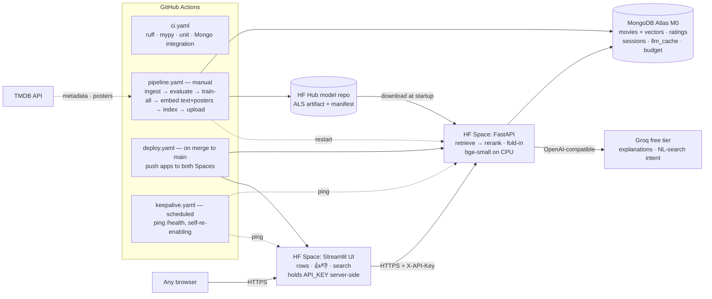

# Movie Recommender — Implementation Plan

## Context

A portfolio project: a Netflix-style movie recommendation product that demonstrates applied-AI / ML-engineering skills end to end. It covers a classical collaborative-filtering core, text and CLIP-poster vector search in MongoDB, anonymous sessions that re-personalize in real time from 👍/👎 votes, a grounded LLM layer for explanations and natural-language search, and a FastAPI ↔ Streamlit service split. All of it is **deployed live on free cloud tiers** with automated CI/CD and an automated data/training pipeline.

**The deciding constraint (re-plan 2026-11-25):** the demo must be live whenever someone clicks the link, at **$0/month**, with **nothing running on the owner's machine, ever** — not serving, not batch jobs, not training, not deploys. The original plan served everything from a home GPU PC through a Cloudflare Tunnel. That made the demo depend on the PC being on, so it was replaced. Full rationale and the approaches considered are in `docs/superpowers/specs/2026-11-25-cloud-hosted-replan-design.md`.

The plan runs as **11 independent, mergeable sessions**. Each ends with a working repo, real tests, and a demo. From Session 5 on, every merge to `main` deploys to the live URLs.

### Locked decisions
- **Hosting:** two free **Hugging Face Spaces** (Docker SDK, CPU): one runs FastAPI, one runs Streamlit. Streamlit calls the API over HTTPS with `X-API-Key`; the key lives only in the two Spaces' secrets, never in the browser.
- **Database:** **MongoDB Atlas M0** (free, 512 MB). It holds the catalog and vectors, ratings, sessions, and the LLM cache, and serves `$vectorSearch`. Local dev and CI use the `mongodb/mongodb-atlas-local` container, which runs the same `$vectorSearch` code.
- **Offline work runs on GitHub Actions, not locally.** A manual `pipeline.yaml` does ingest → evaluate → train on all data → embed text + posters (CPU) → build indexes → upload the model artifact to a free **HF Hub model repo**.
- **LLM:** a **free Groq API tier** through an OpenAI-compatible client (`LLM_BASE_URL`/`LLM_MODEL`/`LLM_API_KEY`, so a provider swap is config-only). There is no self-hosted or GPU mode: vLLM, CUDA serving, and Podman are out of the project.
- **Embeddings:** bge-small (384-d) on CPU, **in-process** in the API for query-time embeddings and in the pipeline for the catalog. CLIP ViT-B-32 (512-d) runs on CPU in the pipeline only; there is no online image embedding. The Session 4 GPU embedding microservice is retired in Session 5.
- **Ranking:** two-stage **retrieve → rerank**. ALS/item-item and vector search retrieve candidates; a weighted blend reranks them.
- **Real-time personalization:** anonymous per-browser sessions. Each starts cold from popularity, then re-personalizes on every vote via ALS **fold-in** against fixed item factors (no retraining), content/visual centroid steering, and downvote suppression.
- **Dataset:** `ml-latest-small` stays. The evaluation is framed honestly (see Evaluation Plan).
- **Python 3.12, `uv`, `ruff`, strict `mypy`, `pytest`; GitHub only** (repo, CI, CD). No GitLab.

---

## Non-Goals (scope fence)
- **No self-hosted or GPU mode**, and no dependency on the owner's machine for anything.
- **No paid services** and no card on file.
- **No user accounts** / passwords / OAuth. Identity is anonymous per-browser sessions; the frontend↔backend link is gated by a shared API key + CORS.
- **No streaming data pipeline.** Catalog and training work is batch. The only real-time element is synchronous per-session feedback (vote → recompute on the next request).
- **Live votes do not feed back into training.** The pipeline retrains only on MovieLens. Feeding votes back is a possible later stretch, out of scope.
- **No fine-tuning** of the embedding or LLM models. ALS is trained, but pretrained models are used as-is.
- **No bigger dataset** (ml-25m/32m), no online A/B testing, no mobile app.

## Anti-Goals (failure even if it technically works)
- The demo link is dead or errors after a quiet period.
- A free-tier limit (Groq rate limit, Atlas storage) becomes a 500 or a broken page instead of graceful degradation.
- Any step needs the owner to run something on their own PC.
- A secret (TMDB key, Groq key, Atlas URI, API key, HF token) lands in the repo, the logs, or the browser.

---

## Architecture Overview



**Request flow.** The browser loads the Streamlit Space. Streamlit never touches the database. It calls the FastAPI Space over HTTPS with `X-API-Key`. Each browser connection is an anonymous session (`session_id` kept in `st.session_state` and `st.query_params`); a new or incognito browser gets a fresh id and starts cold.

For `/recommend?session_id=…`, FastAPI:
1. Loads the session from Mongo.
2. With no votes, returns the popularity/quality prior. Otherwise it computes the ALS fold-in user-vector from the upvotes.
3. **Retrieves** candidates from CF and from `$vectorSearch` (text and poster centroids of the liked items).
4. **Reranks** with a weighted blend, suppressing downvoted items and their neighbors.
5. Optionally adds a grounded LLM "why you might like this," cached and budget-gated.

A 👍/👎 `POST`s `/feedback`, and the next `/rows` call reflects it immediately. For `/search`, the LLM parses "something like Arrival but funnier" into a structured intent → vector query + filters. If the LLM is unavailable, the raw query is embedded and plain vector search runs.

**Offline flow.** `pipeline.yaml` runs on a GitHub runner, started by hand (`workflow_dispatch`). It downloads MovieLens, ingests to Atlas (TMDB payloads cached as an Actions cache, not in Atlas), evaluates, retrains on all data, embeds, builds indexes, uploads the artifact to HF Hub, and restarts the API Space so the API loads the new artifact.

---

## Repository Layout (target)

```
movie_recs/
├── .python-version                 # 3.12
├── pyproject.toml                  # deps + groups: dev, serving, ml (torch; CPU wheels in images)
├── uv.lock
├── .env.example                    # documented; real .env gitignored
├── README.md                       # live links, architecture, skills demonstrated, runbook
├── Makefile
├── compose.yaml                    # dev/test only: mongodb (atlas-local)
├── .github/workflows/
│   ├── ci.yaml                     # ruff, mypy, unit, Mongo integration (atlas-local service)
│   ├── pipeline.yaml               # manual: ingest → evaluate → train → embed → index → upload
│   ├── deploy.yaml                 # on main: push api + frontend to their HF Spaces
│   └── keepalive.yaml              # scheduled /health pings; re-enables itself via API
├── deploy/
│   ├── api/                        # HF Space: Dockerfile + README (Space metadata)
│   └── frontend/                   # HF Space: Dockerfile + README (Space metadata)
├── src/movie_recs/
│   ├── config.py                   # pydantic-settings
│   ├── db/                         # client, collections, indexes, vector index defs
│   ├── ingest/                     # movielens, tmdb (+ file cache), join, run, download
│   ├── recsys/
│   │   ├── split.py · als.py · metrics.py · evaluate.py
│   │   ├── train.py                # train-on-all-data serving artifact
│   │   ├── artifact_store.py       # HF Hub upload/download + manifest
│   │   ├── foldin.py               # session user-vector + downvote suppression
│   │   ├── retrieve.py             # CF + text/visual/hybrid vector candidates
│   │   └── rerank.py               # weighted blend
│   ├── embeddings/
│   │   ├── text.py                 # bge-small (CPU)
│   │   ├── image.py                # open_clip posters (CPU, pipeline only)
│   │   └── run.py                  # catalog embed jobs
│   ├── sessions/                   # store.py, profile.py
│   ├── llm/                        # client.py, budget.py, explain.py, nl_search.py
│   ├── api/                        # main.py, auth.py, deps.py, schemas.py, routes_*.py
│   └── frontend/                   # app.py, api_client.py, session.py, rows.py
└── tests/
    ├── unit/                       # pure logic, no I/O
    ├── integration/                # @pytest.mark.integration — Mongo (atlas-local); runs in CI
    ├── live/                       # @pytest.mark.live — against deployed URLs; post-deploy only
    └── fixtures/
```

---

## Data Model (MongoDB Atlas M0)

Single database `movie_recs`. MovieLens `ml-latest-small` (610 users, 9,742 movies, 100,836 ratings) joined to TMDB via `links.csv`.

| Collection | Key fields | Indexes | Why |
|---|---|---|---|
| `movies` | `_id=movieId`, `tmdbId`, `imdbId`, `title`, `year`, `genres[]`, `overview`, `tags[]`, `poster_path`, `popularity`, `vote_average`, `text_embedding[384]`, `poster_embedding[512]` (absent for ~124 poster-less movies) | `{tmdbId}`, `{genres}`, vector `text_vec` (384, cosine), vector `poster_vec` (512, cosine) | Catalog and vectors together, so retrieval and metadata filtering happen in one query. |
| `ratings` | `userId`, `movieId`, `rating`, `timestamp` | `{userId}`, `{movieId}`, `{timestamp}` | Training input and the popularity prior. |
| `users` (derived) | `_id=userId`, `liked_movieIds[]`, `n_ratings`, `last_ts` | `_id` | MovieLens user lookup for offline/eval paths. |
| `sessions` | `_id=session_id`, `created_at`, `last_seen`, `feedback[{movieId,vote,ts}]`, `liked[]`, `disliked[]`, `foldin_vec`, `foldin_stale`, `llm_calls` | **TTL** on `last_seen` (14 d) | Anonymous real-time personalization; the TTL keeps storage bounded. |
| `llm_cache` | `_id=hash(kind, movieId, sorted seed ids / query)`, `text`, `created_at` | **TTL** on `created_at` (14 d) | Saves free-tier quota and keeps explanations stable. |
| `llm_budget` | `_id=YYYY-MM-DD`, `calls` | TTL (3 d) | Global daily LLM-call cap, set below Groq's daily limit. |
| `meta` | `_id="catalog"`, `catalog_version`, `updated_at` | — | Lets the API check that the artifact matches the catalog. |

**Not in Atlas:** `tmdb_cache`. The pipeline keeps TMDB payloads in a file cache persisted as a GitHub Actions cache, since raw payloads aren't needed online. **Storage estimate:** about 70 MB of vectors + metadata plus about 10 MB of ratings, well under 512 MB.

---

## API Surface

All endpoints except `/health` require `X-API-Key`; CORS is restricted to the Streamlit Space origin.

| Method | Path | Request | Response | Purpose |
|---|---|---|---|---|
| GET | `/health` | — | `{status, mongo, artifact:{git_sha, trained_at, catalog_version}}` | Liveness; also the keep-alive target (runs a trivial Mongo ping, so Atlas never looks idle). |
| POST | `/session` | — | `{session_id}` | Mint an anonymous session. |
| POST | `/feedback` | `{session_id, movieId, vote:up\|down}` | `{ok, n_feedback}` | Record a vote; marks fold-in stale. |
| GET | `/movies` | `?q&genre&page&limit` | paged cards | Browse. |
| GET | `/movies/{id}` | — | detail | Detail view. |
| GET | `/recommend` | `?session_id&seed_id&k&explain` | `[{movie, score, reason?}]` | Session-aware two-stage recs. |
| GET | `/similar/{id}` | `?mode=content\|visual\|hybrid&k` | ranked movies | Similarity rows. |
| POST | `/search` | `{session_id?, query, k}` | `{intent?, results[]}` | NL search; `intent=null` on LLM fallback. |
| GET | `/rows` | `?session_id` | titled rows | Home-screen aggregate. |

---

## Recommendation Approach

**Core:** implicit-feedback **ALS** (`implicit`) plus **item-item cosine**, binarized at `rating ≥ 4.0` with confidence weighting. This is the right tool at ml-small scale; deep sequence models would be data-starved.

**Two models, two jobs:**
- *Evaluation models* are trained on a split and scored (see below).
- The *serving model* is then **retrained on all ratings** and is what the API loads. That gives every movie with at least one like a CF factor. Factorless movies, the ones nobody liked, still exist, and every path falls through to content/visual similarity for them.

**Two-stage pipeline:**
1. **Retrieve:** the union of CF neighbors of liked items and `$vectorSearch` neighbors (text centroid; poster centroid for visual rows). Vector retrieval is what reaches new or factorless items.
2. **Rerank:** `w1·CF + w2·content_sim + w3·visual_sim + w4·popularity + w5·recency`, with config-driven weights.

**Real-time session personalization:**
- **ALS fold-in.** Solve a ridge least-squares for the session's user-vector from its upvoted items' fixed factors. It takes milliseconds, is cached on the session doc, and is recomputed lazily when `foldin_stale`.
- **Content/visual steering.** The centroid of the upvoted items' embeddings drives `$vectorSearch`.
- **Downvote suppression.** Downvoted items and their nearest neighbors are penalized or removed.

**Cold start:**
- *New session:* popularity prior plus an "upvote a few to personalize" nudge.
- *New or factorless item:* content and poster similarity.

**LLM layer (presentation + query understanding, never the ranking):**
- **Explanations** are grounded only in the item's real metadata and the session's upvoted titles.
- **NL-search intent** is parsed with structured output and validated by pydantic.
- **Guarding the free tier:**
  - Every LLM call goes through a cache, then a per-session cap, then a global daily budget.
  - On a cache miss with an exhausted budget, a 429, or a timeout, the result is `None`, and the API degrades to `reason=None` or plain vector search. It never returns a 500.

---

## Evaluation Plan

- **Primary split: per-user leave-one-out** (each user's most recent liked interaction held out; 573 evaluable users). It is reported first because it's the only split with enough users to be meaningful on ml-small.
- **Secondary split: global temporal cutoff.** It's leakage-safe but leaves only about 27 evaluable users on this dataset (users rate in short bursts). It is reported with an explicit small-n label, not hidden.
- **Metrics:** Precision@k, Recall@k, NDCG@k, MAP@k (k ∈ {10, 20}), catalog coverage, intra-list diversity.
- **Bar:** ALS beats **popularity and random** on NDCG@10 and Recall@10 on the primary split. There's no absolute target: ml-small numbers are modest and noisy, and the README says so. The previous "NDCG@10 ≈ 0.10–0.35" target is withdrawn because it didn't match this dataset.
- The pipeline writes the metrics table into the artifact manifest, so the deployed model's numbers are visible at `/health` and in the README.

---

## Dev & Deploy Setup

**Nothing runs on the owner's machine.** Development can happen in any environment, including cloud coding sessions. Local Docker is optional and only provides a Mongo for integration tests.

**Accounts (all free):** GitHub (repo public, so Actions minutes are unlimited), MongoDB Atlas (M0 cluster), Hugging Face (two Spaces + one model repo), Groq (API key), TMDB (API key).

**Secrets:**

| Secret | Where | Used by |
|---|---|---|
| `TMDB_API_KEY` | GitHub Actions secret | pipeline |
| `MONGODB_URI` (Atlas, scoped DB user) | Actions secret + API Space secret | pipeline, API |
| `HF_TOKEN` (write to the Spaces + model repo) | Actions secret (+ API Space secret if the model repo is private) | deploy, pipeline, API |
| `API_KEY` (random 32+ bytes) | API Space secret + frontend Space secret | API, frontend |
| `LLM_API_KEY` (Groq) | API Space secret | API |

**Non-secret config** (Space variables / `.env.example`): `MONGODB_DB`, `FRONTEND_ORIGIN`, `API_BASE_URL`, `LLM_BASE_URL=https://api.groq.com/openai/v1`, `LLM_MODEL`, `TEXT_EMBED_MODEL=BAAI/bge-small-en-v1.5`, `CLIP_MODEL=ViT-B-32`, `HF_ARTIFACT_REPO`, `LLM_DAILY_BUDGET`, `LLM_SESSION_CAP`.

**Atlas network access:** `0.0.0.0/0`, because HF Spaces and GitHub runners have dynamic IPs. This is mitigated by a long random password and a DB user scoped to `movie_recs` only.

**Local tests (optional):**
```
docker compose up -d mongodb
uv run pytest                    # unit
uv run pytest -m integration     # Mongo
```

---

## Sessions

Each session ends mergeable to `main`, keeps the repo runnable, ships real (non-smoke) tests, and produces a demo. Sessions 1–4 are complete and kept as written for history. Session 5 retires the parts of Session 4 that assumed a home GPU.

### Session 1 — Foundation: `uv`, config, tooling, CI
**Goal:** Turn the bare scaffold into a properly configured `uv` project with linting, testing, config, and green CI.
**Depends on:** none
**Branch:** `feat/foundation`

**Scope**
- Change `.python-version` → `3.12`; restructure to `src/movie_recs/` layout in `pyproject.toml` with dependency groups (`dev`: pytest, ruff; core deps added as sessions need them). Regenerate `uv.lock`.
- `src/movie_recs/config.py` — `pydantic-settings` reading `.env`; `.env.example`; `.gitignore` confirms `.env`, `data/`, `.venv`.
- `Makefile` wrappers (`test`, `lint`, `fmt`), ruff config, `.github/workflows/ci.yaml` running `uv sync --frozen` → `ruff check` → `pytest`.
- Replace `main.py` with a package entrypoint + a trivial `health()`/version function.
- Default choice: `src/` layout (cleaner packaging) over flat.

**Out of scope** (deferred): all domain code — DB, ingest, models (Sessions 2+).

**Tests**
- `config` loads values from a temp `.env`, applies defaults, and rejects a malformed value (assert raised).
- `health()`/version returns the expected pinned version string.
- CI workflow is valid and passes on the branch.
- Run: `uv run pytest && uv run ruff check`

**Definition of done**
- [x] `.python-version` is `3.12`; `uv sync --frozen` succeeds cleanly.
- [x] `uv run pytest` green; `uv run ruff check` clean.
- [x] CI is green on the PR.
- [x] `.env` is gitignored; `.env.example` present.

**Demo:** `uv run pytest -q` and a green CI check on the PR.
**Est. effort:** **S** — pure setup, no domain logic, but establishes conventions every later session relies on.

**Status: done** — merged to `main` via PR #1 (`feat/foundation`, `5f504d4`) and PR #2 (`fix/ci-node24`, CI Node 24 action-version fix, `b8a3e0b`). Also added `mypy` to the tooling beyond the plan's original scope — see Decision Log.

---

### Session 2 — Data ingestion: MovieLens + TMDB → MongoDB
**Goal:** Populate MongoDB with the joined catalog + ratings from MovieLens and TMDB.
**Depends on:** 1
**Branch:** `feat/ingest`

**Scope**
- `compose.yaml` gains the `mongodb/mongodb-atlas-local` service (persisted volume).
- `src/movie_recs/db/` — Mongo client + collection accessors + index bootstrap.
- `src/movie_recs/ingest/` — `movielens.py` (parse movies/ratings/links/tags), `tmdb.py` (rate-limited, cached httpx client using `TMDB_API_KEY`, writes `tmdb_cache`), `join.py` (movieId↔tmdbId via links), `run.py` (idempotent upserts into `movies`, `ratings`, derived `users`).
- pydantic schemas validate every document before insert.
- Default choice: `--sample` flag to ingest a small fixed subset for fast local/CI runs.

**Out of scope** (deferred to 3–5): any modeling, embeddings, vector indexes.

**Tests**
- MovieLens parsing: fixture CSVs → correct doc counts/shapes; genres split; year parsed from title.
- Join: a known `movieId` maps to the right `tmdbId`; unmatched rows handled without crashing.
- TMDB client: mocked HTTP (respx) returns cached payload on second call (no second request); missing-poster tolerated.
- Upsert idempotency: running ingest twice yields identical counts (integration, `@pytest.mark.integration` against atlas-local).
- Run: `uv run pytest -m "not integration"` (unit) and `uv run pytest -m integration` (with Mongo up).

**Definition of done**
- [x] `docker compose up mongodb` + `uv run python -m movie_recs.ingest --sample` populates `movies`/`ratings`.
- [x] `mongosh` shows expected counts; a sampled movie has TMDB `overview` + `poster_path`.
- [x] Re-running ingest does not duplicate documents.

**Demo:** ingest command, then a `mongosh` count + one joined document printed.
**Est. effort:** **M** — external API, caching, join logic, first container.

**Status: done** — verified end-to-end against a real local Docker/Mongo + a real TMDB key (not just fixtures): `docker compose up mongodb`, then `uv run python -m movie_recs.ingest --sample` twice gave identical counts both times (`movies: 200, ratings: 6351, users: 553`), confirmed via `mongosh` counts + a sampled `movies` doc (Toy Story, with `overview`/`poster_path` populated). Also parse/join-tested against the full real dataset (9,742 movies, 100,836 ratings) before the Mongo run. Two bugs found and fixed during this verification pass (not scope deviations, just bugs — no Decision Log entry): (1) `.env.example`'s blank-secret lines (`API_KEY=`, `FRONTEND_ORIGIN=`, `CLOUDFLARE_TUNNEL_TOKEN=`) broke `python-dotenv`, which only strips a trailing `# comment` when a real value precedes it — an empty value swallowed the whole comment as its literal string, failing `Settings()` validation; fixed by moving those comments to their own line + adding `env_ignore_empty=True`. (2) `httpx`'s request logger printed the full TMDB URL at INFO level, including `api_key=...` in the query string, once `logging.basicConfig(level=INFO)` was set — fixed by pinning the `httpx` logger to WARNING in `ingest.run.main()`.

---

### Session 3 — CF core (ALS + item-item) + offline evaluation
**Goal:** Train the collaborative-filtering models and produce a leakage-safe metrics table. *(Architecture-defining — placed early.)*
**Depends on:** 2
**Branch:** `feat/recsys-core`

**Scope**
- `recsys/split.py` — global temporal split; `recsys/als.py` — build scipy sparse matrix, binarize `rating≥4`, train `implicit` ALS + item-item cosine; persist **item factors + regularization** (reused verbatim by the Session 7 fold-in) and item-item neighbors.
- `recsys/metrics.py` — precision@k, recall@k, NDCG@k, MAP@k, coverage, intra-list diversity.
- `recsys/evaluate.py` — runs ALS vs item-item vs popularity vs random, prints a metrics table.

**Out of scope** (deferred to 6): serving these via the API; (deferred to 4/5): embeddings.

**Tests**
- Temporal split has **no leakage**: every test interaction's timestamp ≥ the cutoff and > that user's train max (assert).
- Metric functions match hand-computed values on a tiny fixture (e.g., NDCG@3, Precision@2, MAP on a 3-item ranking).
- ALS on a tiny synthetic matrix returns a ranked list of correct length excluding already-seen items.
- Coverage/diversity math on a known set.
- ALS **beats popularity** on NDCG@10 on the sample (guards against a broken pipeline).
- Run: `uv run pytest tests/unit/test_recsys*.py`

**Definition of done**
- [x] `uv run python -m movie_recs.recsys.evaluate` prints a models×metrics table.
- [x] ALS beats the popularity baseline on NDCG@10/Recall@10.
- [x] Model artifacts persist and reload.

**Demo:** run `evaluate` and show the printed metrics table.
**Est. effort:** **L** — the ML heart of the project; correctness of split + metrics is subtle and heavily tested.

**Status: done** — verified against the real, fully-ingested dataset (9,742 movies, 100,836 ratings, 610 users). `uv run python -m movie_recs.recsys.evaluate` prints two labeled tables (see Decision Log) and persists `artifacts/recsys/model.pkl`; reload verified separately (`load_artifact` returns correct shapes/values, and item-item neighbors for Toy Story sanity-check correctly: Toy Story 2, Aladdin, Star Wars, Shawshank as top matches). ALS beats popularity on NDCG@10 (0.0284 vs 0.0252) and Recall@10 (0.0628 vs 0.0489) on the secondary (leave-one-out) split — see Decision Log for why the primary (global) split doesn't show this cleanly on this real dataset, and why the secondary split is the one that satisfies this DoD item. 46 unit tests pass (`uv run pytest -m "not integration" -q`); `test_als_beats_popularity_on_ndcg10` pins the win on synthetic block-clustered data (large, non-flaky margin) as the fast CI-safe guard, since the real-data win depends on Mongo.

---

### Session 4 — Embedding service + text vector search
**Goal:** Stand up the GPU embedding microservice and enable semantic (text) retrieval via MongoDB `$vectorSearch`.
**Depends on:** 2 (movies), 3 (shares recsys utils)
**Branch:** `feat/embeddings-text`

**Scope**
- **First task — resolve the dependency-group deviation** (see Decision Log 2026-08-11): `fastapi`, `uvicorn[standard]`, and `sentence-transformers` are already staged in `[project.dependencies]`, which drags ~3 GB of CUDA torch wheels into every image including the GPU-less API container. Decide and record: move the torch-bearing deps into an optional `ml`/`serving` group (matches the Repository Layout's stated groups and keeps `api.Dockerfile` lean), or accept a fat API image. **This must be settled before the Session 4 commit, not after.**
- `embeddings/service.py` (+ `text.py`) — FastAPI service exposing `/embed/text`, backed by sentence-transformers (`bge-small-en-v1.5`, 384-dim); `docker/embedding.Dockerfile` (torch + CUDA, **CUDA 12.8+ base for Blackwell `sm_120` — see Risk #1**); added to `compose.yaml` with an explicit GPU reservation (Docker's default runtime is `runc`).
- Offline job: embed each movie's `title+overview+genres+tags`, store `text_embedding`, create the `text_vec` vector index. **122 of 9,742 movies have no `overview`** — the text builder must fall back to `title+genres+tags` rather than skipping or embedding an empty string.
- Index readiness: `$vectorSearch` indexes build asynchronously on atlas-local, so the job must poll for readiness before querying (Risk #6).
- `recsys/retrieve.py` — semantic KNN retrieval function over `$vectorSearch`.

**Out of scope** (deferred to 5): poster/CLIP; (deferred to 6): API endpoints; (deferred to 8): LLM.

**Tests**
- Embedding endpoint returns a 384-dim vector for text; batch endpoint preserves order (mock/small model).
- Vector index creation succeeds; `$vectorSearch` returns nearest neighbors for a seed movie where a known-similar title ranks in top-k (integration vs atlas-local).
- **Item cold-start:** a freshly inserted movie with zero ratings is retrievable by content similarity.
- Deterministic dims asserted even when the model is stubbed for unit runs.
- Text-builder fallback: a movie with no `overview` still yields a non-empty embedding input from `title+genres+tags` (pure-logic unit test, no model needed).
- Run: `uv run pytest -m integration tests/integration/test_vector*.py`

**Definition of done**
- [x] `curl embedding:/embed/text` returns a vector.
- [x] Embed-catalog job populates `text_embedding` on **all 9,742 movies** (the 122 without an `overview` included, via fallback) + builds `text_vec`, and the job is idempotent on re-run.
- [x] "Movies like Toy Story" script returns sensible neighbors.

**Demo:** run the embed job, then a `similar-by-text` script for one movie.
**Est. effort:** **M** — new container + vector index, but a single modality.

**Status: done** — verified against the real full catalog and a real GPU container, not fixtures. `docker compose up embedding` builds from `docker/embedding.Dockerfile` (`nvidia/cuda:13.0.1-base-ubuntu24.04`) and reports healthy with `torch.cuda.is_available() == True` on the RTX 5070 inside the container (Blackwell `sm_120` confirmed working end-to-end); `curl :8080/embed/text` returns 384-dim **unit-norm** vectors and `/health` reports the model + dim. `uv run python -m movie_recs.embeddings` embedded all **9,742/9,742** movies in ~37 s and created `text_vec` (READY); a re-run embeds 0 (idempotent). `similar_by_text(1)` (Toy Story) returns Toy Story 3 (0.918), Toy Story 2 (0.913), The Toy, then Child's Play/Space Jam/Elf; a free-text query ("bleak dystopian film about surveillance and control") returns Black Mirror: White Christmas, Equilibrium, The Thinning; and a no-`overview` movie (the 122-movie fallback path) returns coherent same-genre documentaries. 72 unit tests + 7 integration tests pass, `ruff` and `mypy` clean. Two real bugs found by the integration run and fixed (see Decision Log): the index-readiness poll treated "not listed yet" as a hard error, and the tests raced `mongot`'s asynchronous indexing.

**Superseded in part by the 2026-11-25 re-plan:** the GPU embedding microservice (`embeddings/service.py`, `docker/embedding.Dockerfile`, the `embedding` compose service) is retired in Session 5; `TextEmbedder`, the text builder, `text_vec`, and retrieval carry forward unchanged and run on CPU.

---

### Session 5 — Cloud foundation: Atlas, pipeline, serving artifact, CI integration, API Space skeleton
**Goal:** Stand up the walking skeleton. Data lives in Atlas, a GitHub Actions pipeline builds it with no local machine, the served model is trained on all data, CI runs Mongo integration tests, and a minimal FastAPI Space is live, auto-deployed, and kept awake.
**Depends on:** 1–4
**Branch:** `feat/cloud-foundation`
**Detailed task plan:** `docs/superpowers/plans/2026-11-25-session-5-cloud-foundation.md`

**Scope**
- **Retire the GPU embedding service:** delete `embeddings/service.py`, `tests/unit/test_embeddings_service.py`, `docker/embedding.Dockerfile`, and the `embedding` compose service. Drop `embed_base_url`, `vllm_*`, and `cloudflare_tunnel_token` from `config.py` and `.env.example`; add `llm_*`, `hf_artifact_repo`, and `hf_token`. `TextEmbedder` stays as the in-process CPU embedder.
- **Ingest for the cloud:**
  - `ingest/download.py` fetches and unzips `ml-latest-small` from GroupLens.
  - `FileTmdbCache` (JSON files under a directory) replaces `MongoTmdbCache` in the pipeline.
  - `ingest.run` writes with `bulk_write` batches instead of one `replace_one` per document (100k round-trips to Atlas would take tens of minutes).
- **Evaluation reframing:** `evaluate.py` reports leave-one-out as **Primary** and the global split as **Secondary (small-n)**, and returns both tables for the manifest.
- **Serving artifact:** `recsys/train.py` retrains ALS and item-item on **all** ratings, plus a popularity prior. `recsys/artifact_store.py` uploads/downloads `model.pkl` and `manifest.json` (git SHA, trained_at, catalog_version, metrics) to the HF Hub model repo.
- **`pipeline.yaml`** (`workflow_dispatch`): download → ingest → evaluate → train → embed text → build `text_vec` → write `meta.catalog_version` → upload artifact → restart the API Space.
- **CI:** an `atlas-local` service container in `ci.yaml`, with `pytest -m integration` added as a step.
- **API Space skeleton:** `api/main.py` with `/health` only, reporting Mongo status and the artifact manifest. `deploy/api/Dockerfile` uses CPU-only torch. `deploy.yaml` pushes on merge to `main`. `keepalive.yaml` pings every 12 h and re-enables itself via the GitHub API.
- **Docs hygiene:** README gets a first draft with the live link, a "Skills demonstrated" list, and the runbook.

**Out of scope:** CLIP (6), recommendation endpoints (7), sessions (8), LLM (9), UI (10).

**Tests**
- `FileTmdbCache` round-trips a payload and returns `None` for a miss.
- `download_movielens` extracts the expected CSVs from a fixture zip, and skips the download when the files already exist.
- Bulk ingest is idempotent (integration; same counts twice), now running in CI.
- `train_serving_artifact` gives a factor to every movie with ≥1 like in the input, and `popularity` is sorted descending.
- The artifact manifest round-trips, and `upload`/`download` call the HF Hub client with the right repo and filenames (mocked).
- `evaluate.run` labels leave-one-out "Primary".
- `/health` returns 200 without a key and reports `mongo: "ok"` / `"down"` correctly (TestClient, with a stub DB ping).

**Definition of done**
- [ ] `pipeline.yaml` run on GitHub populates Atlas (9,742 movies with `text_embedding`, `text_vec` READY) and uploads an artifact whose item factors cover every movie with ≥1 like.
- [ ] CI green with the Mongo integration tests running.
- [ ] `https://<api-space>.hf.space/health` returns the artifact manifest; a merge to `main` redeploys it with no manual step.
- [ ] No GPU, vLLM, Cloudflare, or GitLab references remain in code, config, or compose.

**Demo:** trigger `pipeline.yaml` from the GitHub UI, then open the live `/health` and show the manifest's metrics.
**Est. effort:** **L** — four accounts and three new workflows, but little new domain logic.

---

### Session 6 — CLIP poster embeddings + visual/hybrid retrieval
**Goal:** Multimodal poster embeddings, computed on CPU in the pipeline, and visual similarity retrieval.
**Depends on:** 5
**Branch:** `feat/embeddings-visual`

**Scope**
- `embeddings/image.py`: open_clip `ViT-B-32` (512-d, unit-norm), loaded lazily like `TextEmbedder`. Poster download from TMDB `w185` URLs, with a file cache persisted as an Actions cache.
- Pipeline step: embed posters → `poster_embedding` → `poster_vec` index. The ~124 poster-less movies and any corrupt images are skipped and counted, and never crash the run.
- `recsys/retrieve.py`: `similar_by_poster` and `similar_hybrid` (merge and dedupe the text and visual candidate sets, max-score per movie).

**Tests**
- The image embedder returns 512-d unit vectors (stubbed model).
- A corrupt image or a 404 poster is skipped and counted.
- Hybrid merge dedupes and keeps the max score.
- `poster_vec` search returns a same-franchise neighbor in the top k (integration, loose assertion, in CI with fixture vectors).

**Definition of done**
- [ ] The pipeline embeds about 9.6k posters on a GitHub runner in under 2 h. Record the actual time.
- [ ] Poster-less movies remain retrievable by text.
- [ ] A visual-similarity script against Atlas returns plausible neighbors.

**Demo:** visual neighbors for a franchise title.
**Est. effort:** **M**

---

### Session 7 — Recommendation API: two-stage retrieve → rerank, API key, CORS
**Goal:** Serve recommendations from the live API Space, with cold-start-aware two-stage ranking behind an API key.
**Depends on:** 5, 6
**Branch:** `feat/api`

**Scope**
- `api/deps.py`: Mongo, the artifact (downloaded once at startup), and the in-process `TextEmbedder`.
- `api/auth.py`: `X-API-Key`. CORS limited to `FRONTEND_ORIGIN`.
- `recsys/rerank.py`: weighted blend with config-driven weights. A missing CF factor contributes 0 to the CF term, not an error.
- Endpoints: `/movies`, `/movies/{id}`, `/recommend` (by `seed_id` until Session 8), `/similar/{id}`, `/rows`. `reason=None` until Session 9.
- On startup, log a warning if the artifact's `catalog_version` ≠ `meta.catalog_version`.

**Tests**
- No key → 401; correct key → 200; `/health` needs no key.
- CORS: an allowed origin passes and another origin is refused.
- Contract tests for each endpoint; 404 on an unknown id.
- The reranker orders a fixture deterministically, and a factorless candidate still ranks by content.
- Cold start with no signal returns popularity.

**Definition of done**
- [ ] The live `/docs` is up. `curl -H "X-API-Key: …" https://<api-space>/recommend?seed_id=1&k=10` returns ranked, scored items, and a call without the key returns 401.

**Demo:** live curl calls, with and without the key.
**Est. effort:** **L**

---

### Session 8 — Real-time session personalization (fold-in + feedback)
**Goal:** Anonymous sessions whose recommendations re-personalize from 👍/👎 on the next request.
**Depends on:** 7
**Branch:** `feat/sessions-realtime`

**Scope**
- `sessions/store.py` and `sessions/profile.py`: the Mongo `sessions` collection with a 14-day TTL on `last_seen`. Covers create/get, append feedback, `liked`/`disliked`, and a cached `foldin_vec` with a stale flag.
- `recsys/foldin.py`: ridge fold-in against the fixed item factors, using the artifact's `regularization`. Factorless upvotes contribute no CF signal but still steer the content/visual centroid. Downvote suppression covers the item and its CF/vector neighbors.
- `POST /session`, `POST /feedback`. `/recommend` and `/rows` accept `session_id`. A per-session vote cap (e.g. 500) bounds abuse.

**Tests**
- Fold-in ordering on a tiny fixture.
- After upvotes the list changes toward similar items; a downvote removes the item and its nearest neighbor.
- Two sessions stay isolated.
- A factorless upvote doesn't raise and still steers the results.
- Feedback survives an API restart (re-read from Mongo).
- The TTL index exists on `sessions`.

**Definition of done**
- [ ] On the live API: new session → popularity; upvote → the next `/recommend` changes toward similar titles; downvote → suppressed; two sessions are independent.

**Demo:** live curl loop: session → recs → upvote → changed recs.
**Est. effort:** **L**

---

### Session 9 — LLM layer (Groq): grounded explanations + NL search, budgeted
**Goal:** "Why you might like this" and natural-language search through a free LLM API, without a free-tier limit ever breaking the page.
**Depends on:** 7, 8
**Branch:** `feat/llm`

**Scope**
- `llm/client.py`: OpenAI-compatible (`openai` SDK with `base_url`). Timeout 10 s, one retry, and `None` on 429, timeout, or 5xx. The model is chosen from Groq's then-current free models (a small Llama-family instruct model); record the choice in the Decision Log.
- `llm/budget.py`: per-session cap (`LLM_SESSION_CAP`, stored on the session) plus a global daily cap (`LLM_DAILY_BUDGET`, an atomic `$inc` on `llm_budget`).
- `llm/explain.py`: prompt built only from the item's title, year, genres, and overview and the session's upvoted titles. Cached in `llm_cache` (14-day TTL) keyed by (movieId, sorted upvoted ids).
- `llm/nl_search.py` + `POST /search`: JSON-mode intent `{seed_title?, genres[], mood[], keywords[]}`, validated by pydantic, mapped to a vector query + filters. On failure or exhausted budget, embed the raw query and return `intent=null`.

**Tests**
- The prompt contains the grounding facts and nothing else from outside the metadata.
- Canned LLM JSON → expected intent; malformed JSON → fallback path.
- A cache hit makes no client call.
- An exhausted session or daily budget gives `reason=None` / `intent=null`, never a 500.
- A Groq 429 (mocked with respx) degrades gracefully.

**Definition of done**
- [ ] Live `/search` for "like Arrival but funnier" returns an intent and results. Live `/recommend?explain=true` returns short grounded reasons.
- [ ] With the daily budget set to 0, both endpoints still return 200 with fallbacks.

**Demo:** live search + explanations, then the budget-exhausted fallback.
**Est. effort:** **M/L**

---

### Session 10 — Streamlit UI Space with real-time voting
**Goal:** A Netflix-style frontend, live on its own Space, where 👍/👎 re-personalizes rows on the next render.
**Depends on:** 7, 8, 9
**Branch:** `feat/frontend`

**Scope**
- `frontend/app.py`, `api_client.py` (httpx; the only data path; injects `X-API-Key` from the Space secret), `session.py` (`session_id` in `st.session_state` and `st.query_params`), `rows.py`.
- Rows: "Recommended for you," "Because you upvoted X," "Visually similar," genre rows. Poster grid, detail view, search bar, reasons when present. A first-visit nudge to "upvote 3–5 to personalize."
- A friendly "waking up the API…" state with retry when the API Space is cold, instead of a stack trace.
- `deploy/frontend/Dockerfile`; `deploy.yaml` also pushes this Space; `keepalive.yaml` also pings it.

**Tests**
- `api_client` with mocked httpx: URLs, params, the key header present, error mapping.
- `session.py`: new id on a fresh run, reused from `query_params`.
- Pure tests for `rows.py`.
- `AppTest`: a 👍 calls `/feedback` and then refetches `/rows`.
- A cold-API timeout renders the waking-up state.

**Definition of done**
- [ ] The public Streamlit URL renders rows with posters. Voting changes "Recommended for you." An incognito window gets independent recs. The key never reaches the browser (check page source and network tab).

**Demo:** open the live URL on a phone, vote, and watch the rows change.
**Est. effort:** **M**

---

### Session 11 — Hardening, live E2E, README
**Goal:** A demo you can put on a resume and trust: verified end to end against production, with docs a stranger can follow.
**Depends on:** 1–10
**Branch:** `feat/polish-e2e`

**Scope**
- `tests/live/test_e2e.py` (`@pytest.mark.live`) runs in a post-deploy job in `deploy.yaml` against the deployed URLs: `/health` green, then session → popularity → upvote → different list, then `/search` 200.
- Abuse review: per-session caps confirmed, plus a simple per-session rate limit on `/feedback` and `/search`. Check HF Spaces behavior under a burst.
- Storage check: Atlas usage after a pipeline run plus N sessions, recorded against the 512 MB limit.
- Keep-alive check: confirm the self-re-enable step works, and that the Spaces and Atlas stayed awake through a 7+ day quiet window.
- `README.md` final: live links, architecture diagram, "Skills demonstrated," the metrics table from the manifest, screenshots/GIF, an honest notes section (ml-small numbers, free-tier wake-ups), and the full runbook (accounts, secrets, running the pipeline).

**Definition of done**
- [ ] The live E2E job passes after a deploy.
- [ ] The demo has stayed up for a week with no manual action.
- [ ] A stranger can reproduce the deployment from the README using only free accounts.

**Demo:** the README's live link and the post-deploy E2E check.
**Est. effort:** **M**

---

## Research Notes (sources → decision informed)

- **MongoDB vector search** — `mongodb/mongodb-atlas-local` bundles `mongot` for local `$vectorSearch`, and the same aggregation runs on Atlas clusters, including the free tier (subject to a search-index count limit; this project needs two). → **One store for catalog and vectors, with identical code for local tests and production.** ([Atlas local dev](https://www.mongodb.com/company/blog/product-release-announcements/introducing-local-development-experience-atlas-search-vector-search-atlas-cli), [Docker Hub image](https://hub.docker.com/r/mongodb/mongodb-atlas-local))
- **FAISS vs MongoDB vector search** — FAISS is faster but needs a separate store and sync. At about 10k items, consolidating in Mongo wins on simplicity. ([Zilliz FAISS vs Atlas](https://zilliz.com/comparison/faiss-vs-mongodb-atlas))
- **ALS / item-item CF for MovieLens** — strong, standard baselines at this scale. ([Spark ALS docs](https://spark.apache.org/docs/latest/ml-collaborative-filtering.html), [arXiv 2409.05461](https://arxiv.org/pdf/2409.05461))
- **Offline metrics + splitting** — report rank-aware and rank-unaware metrics together. Leave-one-out can leak across time, which is why the global temporal split is still reported alongside it, labeled. ([arXiv 2010.11060](https://arxiv.org/pdf/2010.11060), [Time to Split, RecSys 2025](https://dl.acm.org/doi/10.1145/3705328.3748164))
- **Cold start** — popularity → content → CF as signal accrues; content similarity handles new items. ([Milvus cold-start ref](https://milvus.io/ai-quick-reference/how-do-recommender-systems-handle-coldstart-problems))
- **Fold-in for online personalization** — personalize users unseen at train time without retraining. ([eALS, arXiv 1708.05024](https://arxiv.org/abs/1708.05024))
- **Session-based / interactive recommendation** — adapt to short-lived positive and negative feedback. ([arXiv 1902.04864](https://arxiv.org/pdf/1902.04864))
- **FastAPI + Streamlit split** — separate services talking over HTTP. ([reference repo](https://github.com/davidefiocco/streamlit-fastapi-model-serving))

---

## Risks & Open Questions

1. **Free-tier sleep and pause.** HF Spaces sleep after about 48 h idle. Atlas M0 may pause long-idle clusters. GitHub disables scheduled workflows in public repos after 60 days without activity. *Mitigation:* `keepalive.yaml` pings both Spaces every 12 h (the API's `/health` touches Mongo) and re-enables itself through the GitHub API. *Verify* each platform's current policy at Session 5 and record it in the Decision Log. A rare cold start is acceptable; the UI shows a waking-up state (Session 10).
2. **Free-tier terms can change.** HF, Atlas, and Groq can change their limits. *Mitigation:* the LLM provider is config-only; the README runbook makes the stack reproducible on new accounts; degradation paths mean a lost LLM never takes the site down.
3. **Groq quota exhaustion or abuse.** *Mitigation:* cache → per-session cap → global daily budget → graceful fallback (Session 9). The incognito-session trick can't drain more than the daily budget.
4. **Atlas 512 MB.** Vectors plus ratings come to about 80 MB, so the risk is unbounded growth. *Mitigation:* TTL on `sessions`, `llm_cache`, and `llm_budget`; `tmdb_cache` kept out of Atlas. Measure at Session 11.
5. **Pipeline runtime on CPU runners.** Text embedding is quick; CLIP over about 9.6k posters on 2–4 vCPU could take tens of minutes to an hour or so, and there's a 6 h job limit. *Mitigation:* idempotent, resumable steps (skip already-embedded movies); posters cached across runs.
6. **`$vectorSearch` index lag** (three lags; see Session 4 Decision Log). This applies equally to Atlas. The pipeline waits for READY; tests poll; integration tests use uuid-suffixed DBs.
7. **Pipeline runs write to live data in place.** For a few minutes during a run, results can be stale or mixed. Accepted because runs are rare and manual. The API Space restarts at the end to load the new artifact, and a `catalog_version` mismatch is logged, not fatal.
8. **Public endpoint = abuse surface.** API key + CORS, per-session caps, and rate limits (Session 11). HF Spaces' own fronting absorbs naive floods. This is defense in depth, not user auth (a non-goal).
9. **Atlas network allow-list is `0.0.0.0/0`.** This is required because the clients have dynamic IPs. *Mitigation:* a strong generated password and a DB user scoped to `movie_recs` with readWrite only.
10. **CPU torch image size.** A default `torch` install pulls CUDA wheels (about 5 GB). *Mitigation:* the API image installs torch from the CPU wheel index, keeping the image around 1 GB. Pinned at Session 5.
11. **ml-small is small.** Metrics are modest and noisy. The honest framing is "beats popularity and random." A larger dataset is a documented non-goal.
12. **Cold-start fold-in needs a few votes** before it feels personal. The UI nudge handles this (Session 10).

---

## Verification (whole-plan)

The plan has been executed correctly when every session's PR is green in CI, with the Mongo integration tests included. Merges to `main` deploy both Spaces automatically, and the post-deploy live E2E passes.

On the public Streamlit URL, `/recommend`, `/similar`, and NL `/search` all return grounded results. Voting re-personalizes the rows on the next render, and two browsers get independent recs. An exhausted LLM budget degrades rather than errors.

The demo stays up through a week of no traffic with no manual action. Everything, including the data pipeline, ran without the owner's machine. The served model's manifest shows ALS beating popularity on the primary split.

---

## Decision Log

### 2026-08-09 — Session 1: added mypy to the tooling scope
Why: the plan's Session 1 scope and CI step (`ruff check → pytest`) didn't mention type checking, but the standing working agreement requires mypy-clean on every new/modified module. Adding it now (rather than bolting it on later) keeps every subsequent session's modules type-checked from the start.
Impact: `pyproject.toml` gains `mypy` in the `dev` dependency group plus a `[tool.mypy]` (strict, `pydantic.mypy` plugin — needed for `BaseSettings`'s synthesized `__init__` to type-check) block; `Makefile lint` and `.github/workflows/ci.yaml` both gained a `uv run mypy` step alongside `ruff check`. No scope/sequencing impact on later sessions — same command surface (`make lint`), just stricter.

### 2026-08-09 — Session 2: deferred Mongo-in-CI (Risk #2 mitigation not implemented yet)
Why: Risk #2's stated mitigation ("CI runs unit + Mongo integration") conflicts with Session 1's already-merged CI, which excludes all `@pytest.mark.integration` tests wholesale (a marker also reused for GPU-only tests in Sessions 4/5/8, so it can't be flipped on as-is without splitting it). Asked the user; decided to keep Session 2 scoped to ingestion rather than also redesigning the marker taxonomy and adding a Mongo service container to `ci.yaml`.
Impact: Session 2's Mongo-dependent tests (`@pytest.mark.integration`) run locally only (`docker compose up mongodb` + `uv run pytest -m integration`), same as before. Risk #2's text revised to describe this as the current state, not aspirational. No code/session resequencing; CI catching Mongo-integration regressions remains open, most naturally revisited at Session 10 (full E2E) or whenever it starts to matter.

### 2026-08-10 — Session 3: added the secondary per-user leave-one-out split
Why: the primary global temporal split, run against the real ingested data (610 users, 100,836 ratings spanning 1996-2018), yields only ~27 users with both train and test interactions — real MovieLens users rate in a single bursty time window rather than continuously, so one global cutoff almost never falls inside any individual user's history (confirmed across test_fraction 0.1-0.5: overlap stays ~20-28 users regardless). On that 27-user sample, ALS did not beat popularity on NDCG@10/Recall@10 at any hyperparameter setting tried (swept factors ∈ {8,16,32,64} × regularization ∈ {0.01,0.05,0.1,1.0} × confidence-alpha ∈ {1,10,40}) — not a broken pipeline, just too small/noisy a sample, with popularity being a well-documented strong baseline at this scale. `recsys/split.py`'s Session 3 scope line only named the global split, but plan.md's Evaluation Plan (project-level) already called for "a per-user last-item view... reported secondarily, clearly labeled" — exactly the tool for this. Implemented `leave_one_out_split` (each user's single most recent liked interaction held out) and confirmed it resolves the problem: 573 evaluable users, ALS beats popularity on both NDCG@10 (0.0284 vs 0.0252) and Recall@10 (0.0628 vs 0.0489).
Impact: `evaluate.py` now runs and prints both splits every time (labeled "Primary" / "Secondary"), refactored around a shared `evaluate_split()` helper (`SplitEvaluation` dataclass) so the two runs don't duplicate training/eval logic. The persisted artifact still comes from the primary (global) split, per the plan's own leakage-safety framing for that split. The Session 3 DoD's "ALS beats popularity" is satisfied by the secondary split's result; the primary split's small-n result is reported transparently alongside it, not hidden. No resequencing of later sessions — Session 7's fold-in still reuses the primary split's `item_factors`/`regularization` verbatim as planned.

### 2026-08-11 — Environment confirmed (GPU/CUDA/container runtime) + Session 4 deps staged ahead of code
Why: a long working session was lost when the WSL distro was relocated to a larger drive, so this entry reconstructs and pins what that session established, verified live rather than recalled. Two things happened in it: (1) the GPU stack was set up and (2) Session 4's dependencies were added to `pyproject.toml` without any code behind them.

**Environment (verified 2026-08-11, all commands re-run):** RTX 5070, 12,227 MiB VRAM, compute capability 12.0 (Blackwell `sm_120`), driver 610.43.02 / CUDA UMD 13.3. `nvidia-container-toolkit` 1.19.1 installed with Docker's `nvidia` runtime registered (default runtime remains `runc`); `docker run --rm --gpus all nvidia/cuda:12.6.0-base-ubuntu24.04 nvidia-smi` sees the card. Host venv carries `torch 2.13.0+cu130` with `sm_120` in its arch list and `cuda.is_available() == True`. 74 GB free disk. Mongo (`movie_recs_mongodb`, atlas-local 8.0) is healthy with volumes intact and the **full** dataset — 9,742 movies / 100,836 ratings / 610 users / 9,620 `tmdb_cache` — not the `--sample` subset. Quality gates green at this commit: 46 unit tests pass, `ruff check` clean, `mypy` clean over 31 files, `uv lock --check` consistent.

Impact — this resolves and creates several plan items:
- **Risk #1 resolved and tightened.** The GPU/VRAM question is answered (12 GB, ~10.6 GB usable). New constraint recorded there: three GPU consumers share one card, so `VLLM_GPU_MEMORY_UTILIZATION≈0.70` is the starting budget, to be **measured** at Session 8 rather than assumed. Also added: Blackwell needs CUDA 12.8+ image bases, so the cached `nvidia/cuda:12.6.0-base` is a smoke-test image only, not a base for `docker/embedding.Dockerfile`.
- **Risk #4 resolved.** TMDB key works; `tmdb_cache` (9,620 docs) means Sessions 4/5 need no new API calls.
- **Risks #14, #15, #16 added.** Possible HF gating on `Llama-3.2-3B-Instruct` with no `HF_TOKEN` configured; ~25 GB of images/weights against 74 GB free; and — the substantive one — the artifact holds `item_factors` for only **5,226 of 9,742 movies**, making "no CF factor" the common case that Sessions 6/7 must treat as a normal fall-through to content/visual retrieval, not an error.
- **`.env` gains `HF_TOKEN` and `VLLM_GPU_MEMORY_UTILIZATION`**; a "Reference machine" table was added to Local Dev Setup so the GPU assumptions are written down instead of tribal.
- **Sessions 4/5 gain concrete data-shaped requirements:** 122 movies have no `overview` (text builder must fall back to `title+genres+tags`) and 124 have no `poster_path` (expected-absent `poster_embedding`, must not break hybrid retrieval). Both got DoD/test lines.

**Open deviation, must be resolved before the Session 4 commit:** `fastapi`, `uvicorn[standard]`, and `sentence-transformers` are staged in `[project.dependencies]` (uncommitted, +1118 lock lines, venv already in sync). `sentence-transformers` pulls CUDA torch, so as written every image built from `uv sync --frozen` carries ~3 GB of CUDA wheels — including the GPU-less API container, which contradicts the Repository Layout's stated `dev`/`ml`/`serving` dependency groups and its lean `api.Dockerfile` vs heavy `embedding.Dockerfile` split. Recommended resolution: move the torch-bearing deps to an optional group. Recorded as Session 4's first task; not decided here because it changes `pyproject.toml` structure, which is Session 4 implementation work.

### 2026-08-13 — Session 4: torch-bearing deps moved to a `ml` dependency group (resolves the open deviation)
Why: `fastapi`, `uvicorn[standard]` and `sentence-transformers` were staged in `[project.dependencies]` at the 2026-08-11 entry, which made every `uv sync --frozen` — CI included — pull ~5 GB of CUDA torch wheels for code that doesn't need them. Resolved as recommended, per the Repository Layout's stated `dev`/`ml`/`serving` groups.
Impact: `[dependency-groups]` gains **`serving`** (`fastapi`, `uvicorn[standard]` — the embedding service now, the recommendation API at Session 6) and **`ml`** (`sentence-transformers`, which drags torch). `[tool.uv] default-groups = ["dev", "serving"]` keeps `ml` **out** of the default sync, so CI and the future `api.Dockerfile` stay torch-free; `docker/embedding.Dockerfile` opts in with `uv sync --frozen --no-default-groups --group serving --group ml`, and local GPU work uses `make sync-ml`. Two consequences the code had to absorb: `embeddings/text.py` imports `sentence_transformers` **lazily inside `TextEmbedder.load()`** so `embeddings/service.py` (and its unit tests) import cleanly without torch, and `[[tool.mypy.overrides]]` adds `sentence_transformers.*` to `ignore_missing_imports` since it's absent from CI's environment. Verified: `uv sync --frozen --dry-run` proposes removing torch/nvidia/triton, and the 72 unit tests cover the service's HTTP contract with a stubbed embedder — no GPU, no model download, no torch.

### 2026-08-13 — Session 4: vector-index readiness is three lags, not one (Risk #6 rewritten)
Why: the first real integration run against atlas-local failed in two ways the original one-line "poll for readiness" mitigation didn't cover. `wait_for_vector_index` treated an index that wasn't listed *yet* as a hard `RuntimeError` — but `createSearchIndexes` returns before the index shows up in `list_search_indexes`. And the item-cold-start test asserted a just-embedded movie was searchable the instant it was written, which `mongot`'s asynchronous write-indexing doesn't guarantee. A third lag surfaced while diagnosing: after `drop_database`, `mongot` briefly keeps listing the dropped database's index, so `ensure_vector_index` saw a stale index, skipped creation, and then waited 180 s for an index that was being deleted.
Impact: `wait_for_vector_index` now treats "missing" as not-ready-yet until the timeout (and reports `status=missing` in the `TimeoutError`); the integration tests poll for searchability instead of asserting it, and use a uuid-suffixed database per test rather than the shared `movie_recs_test` name. Risk #6 rewritten to name all three lags, because Sessions 6/7/10 write-then-read the same index (a bootstrap that embeds and immediately serves `/recommend` hits lag (b)). No resequencing; `tests/integration/test_vector_search.py` runs in ~19 s.

### 2026-08-13 — Session 4: the offline embed job runs in-process, not through the embedding service
Why: plan.md's architecture shows an offline "embed catalog" job feeding MongoDB, without saying whether it calls the microservice over HTTP. It doesn't: `movie_recs.embeddings.run` instantiates `TextEmbedder` directly. Sending 9,742 documents through the service's HTTP path would add nothing but serialization overhead and would force `MAX_BATCH` (a guard against one online request pinning the GPU) to accommodate a batch job it wasn't written for.
Impact: `embeddings/run.py` imports `TextEmbedder`; the job is meant to run in the embedding image (or the host venv with `make sync-ml`), both of which already have the model. The HTTP service keeps its documented online role — query-time free-text embeddings for Session 6's `/search` and Session 8's NL search. No plan-level resequencing; noted so Session 10's `scripts/bootstrap.py` wires the job, not an HTTP call.

### 2026-11-25 — Re-plan: always-live, $0, cloud-only hosting (replaces home-PC/GPU serving)
Why: the original plan served the demo from the owner's home GPU PC through a Cloudflare Tunnel, so the public link was only live while that PC was on. For a portfolio piece, a dead link is the worst failure. The owner set three constraints: always live, $0/month, and nothing running on their machine, ever. That includes batch jobs and training, and rules out keeping a "self-hosted mode." Full design and the approaches considered are in `docs/superpowers/specs/2026-11-25-cloud-hosted-replan-design.md`.

Impact:
- **Hosting and data.**
  - Two free HF Spaces (FastAPI, Streamlit) and MongoDB Atlas M0.
  - Offline work moves to a manual GitHub Actions pipeline.
  - The model artifact is stored on the HF Hub.
- **LLM and embeddings.**
  - The LLM moves from vLLM to a free Groq tier through an OpenAI-compatible client.
  - The Session 4 GPU embedding microservice is retired, and embeddings run on CPU in-process.
  - vLLM, CUDA serving, Podman, Cloudflare Tunnel, GitLab, and the reference-machine table are removed.
- **Sessions.**
  - The old Sessions 5–10 become Sessions 5–11, with deployment built first as a walking skeleton (Session 5).
  - Risks #1/7/8/14/15 are dropped.
  - The Risks section is rewritten for free-tier failure modes.
- **Fixes to the plan's own validity, found in review.**
  - (1) The served ALS artifact was trained only on the evaluation split's train set, which is why only 5,226 of 9,742 movies had a factor (old Risk #16). The serving model is now retrained on all ratings.
  - (2) The global temporal split leaves about 27 evaluable users, so leave-one-out (573 users) becomes the primary reported split. The old NDCG@10 target of 0.10–0.35 is withdrawn in favour of "beats popularity and random."
  - (3) Mongo integration tests now run in CI (atlas-local service container), closing the gap left open since Session 2.
- **Public-repo hygiene.** The plan no longer contains employer, team, cost-figure, or resume details. A "Skills demonstrated" README section replaces the resume map. History is not rewritten.
- **Settled calls** (owner can revisit):
  - The pipeline doesn't train on live votes.
  - The keep-alive re-enables itself through the GitHub API instead of making heartbeat commits.
  - Pipeline runs rewrite live data in place and then restart the API.
  - LLM quota is guarded by a cache, a per-session cap, and a global daily budget.
